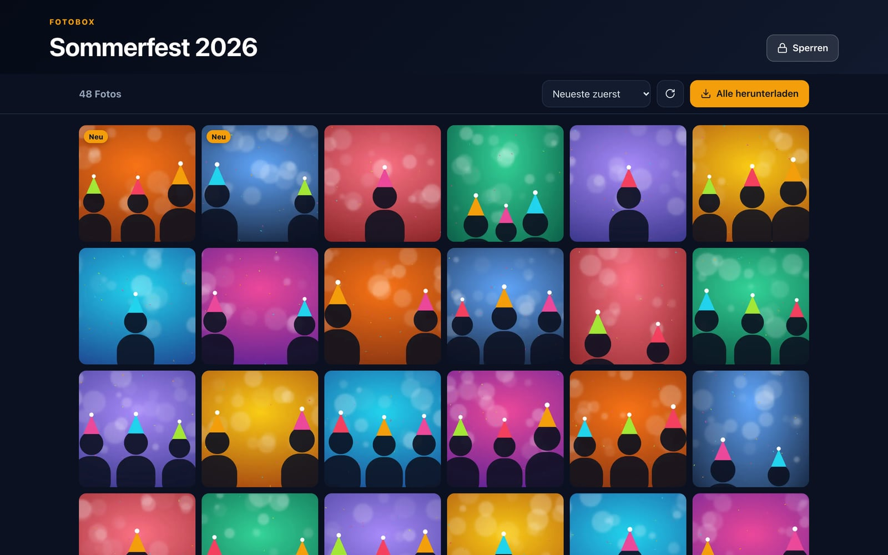
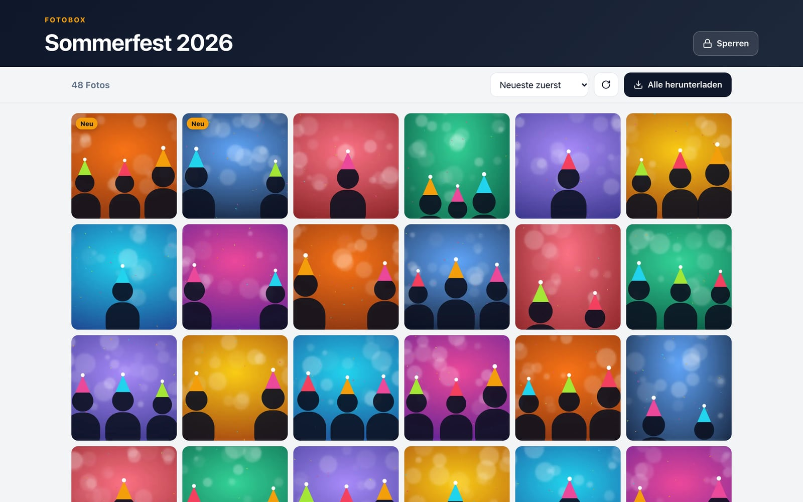
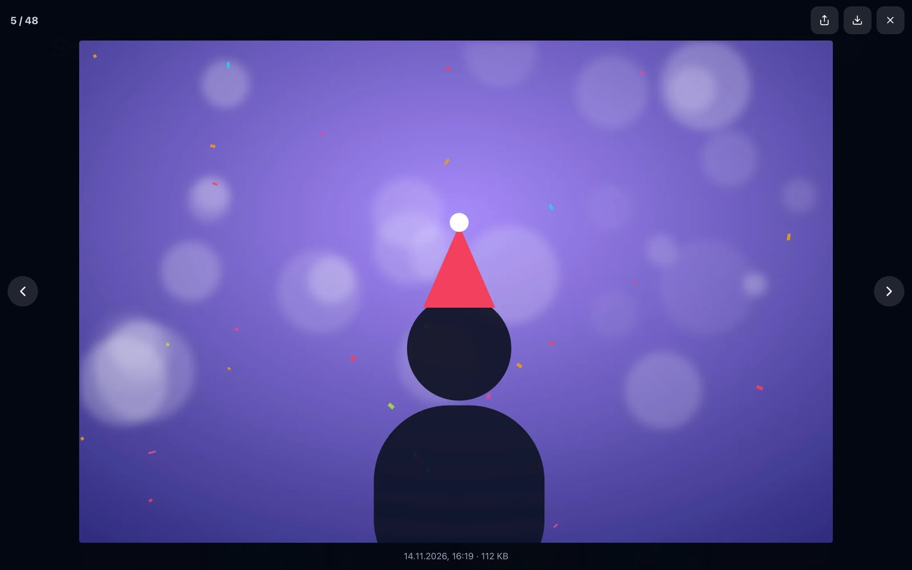
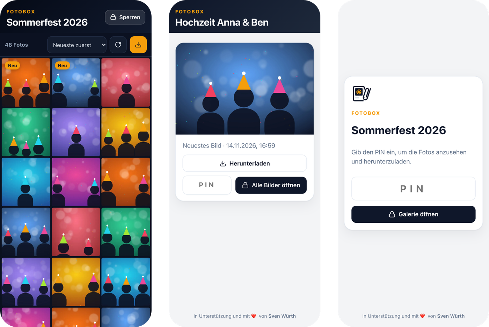
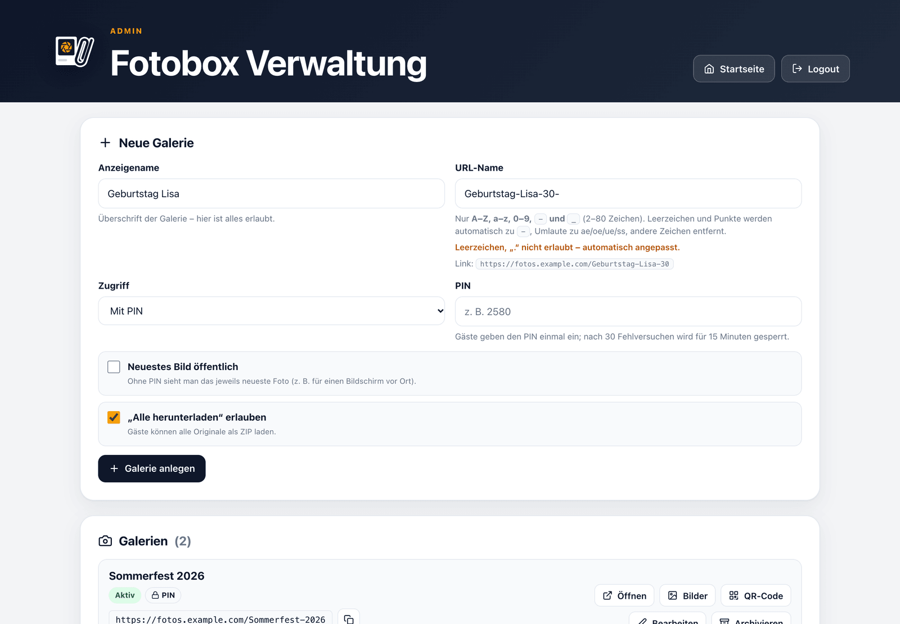
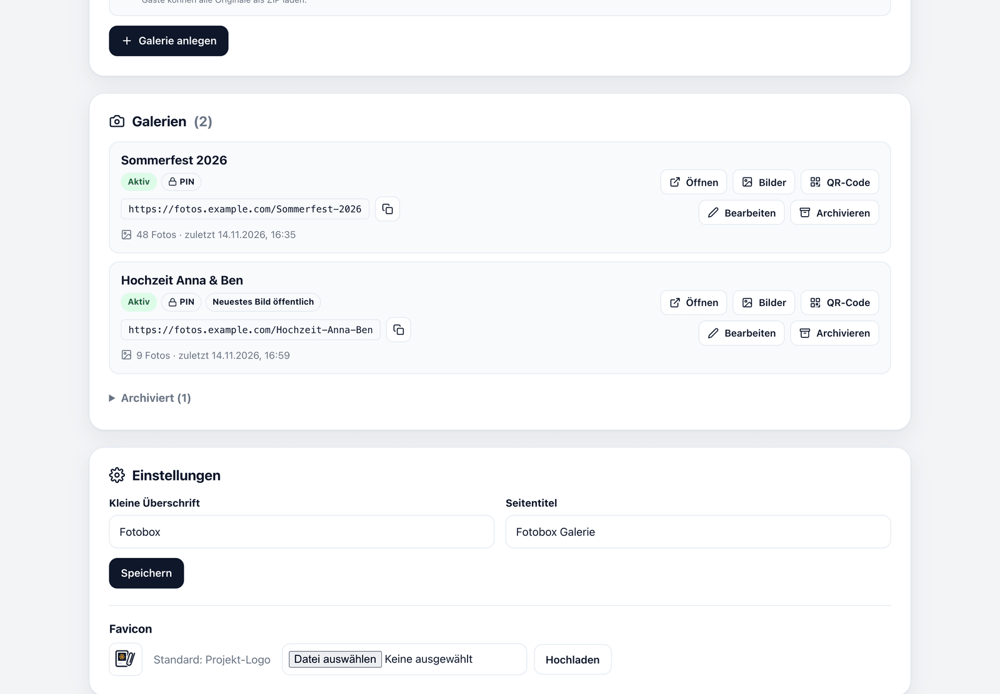
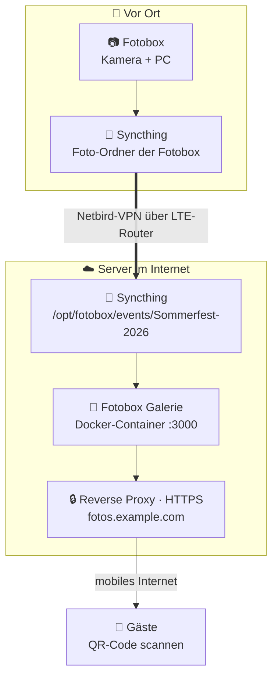
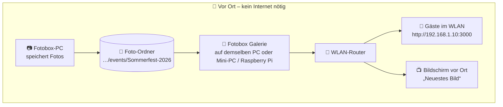

<p align="center">
  
</p>

<h1 align="center">Fotobox Galerie</h1>

<p align="center">
  Selbst gehostete Foto-Galerie für Fotobox-Events.<br>
  Die Fotobox legt ihre Bilder in einen Ordner – die Gäste sehen sie Sekunden später live auf dem Handy.
</p>

<p align="center">
  <a href="https://github.com/its-sven/Fotobox-Gallery-Server/actions/workflows/ci.yml"></a>
  <a href="https://github.com/its-sven/Fotobox-Gallery-Server/actions/workflows/docker.yml"></a>
  <a href="https://github.com/its-sven/Fotobox-Gallery-Server/pkgs/container/fotobox-gallery-server"></a>
  <a href="LICENSE"></a>
</p>

<p align="center">
  
</p>

---

## Inhalt

- [Funktionen](#funktionen)
- [Screenshots](#screenshots)
- [Schnellstart mit einem Befehl](#schnellstart-mit-einem-befehl)
- [Installation mit Docker Compose](#installation-mit-docker-compose-empfohlen)
- [Betriebsbeispiele](#betriebsbeispiele)
- [Erste Galerie anlegen & Fotobox anbinden](#erste-galerie-anlegen--fotobox-anbinden)
- [Konfiguration](#konfiguration)
- [Update & Backup](#update--backup)
- [So funktioniert es](#so-funktioniert-es)
- [Fehlerbehebung](#fehlerbehebung)
- [Entwicklung](#entwicklung)

## Funktionen

**Für Gäste**
- Eigene Adresse pro Event, z. B. `https://fotos.example.com/Sommerfest-2026` – auf Wunsch mit PIN
- Schnelle Galerie mit kleinen Vorschaubildern, Nachladen beim Scrollen und Live-Aktualisierung alle 15 Sekunden
- „Neu“-Markierung für Fotos der letzten 10 Minuten
- Vollbildansicht mit Wischen, Pfeiltasten und großen Blätter-Flächen; Download des Originals, Teilen direkt vom Handy
- „Alle herunterladen“ als ZIP (pro Galerie abschaltbar)
- Optional „Neuestes Bild öffentlich“ – ideal für einen Bildschirm vor Ort
- Helles und dunkles Design, passt sich dem Gerät an

**Für dich als Betreiber**
- Adminbereich: Galerien anlegen, bearbeiten, archivieren; Bilder löschen
- QR-Code pro Galerie (PNG zum Drucken, SVG)
- URL-Namen werden beim Tippen geprüft und automatisch bereinigt
- Vorschaubilder werden im Hintergrund erzeugt, sobald Fotos ankommen
- Läuft als Docker-Container (amd64 & arm64, also auch auf dem Raspberry Pi), ohne root, mit Healthcheck
- Keine Datenbank: alles liegt als Dateien in einem Ordner

## Screenshots

<table>
  <tr>
    <td width="50%"><br><sub>Galerie im hellen Design</sub></td>
    <td width="50%"><br><sub>Vollbildansicht mit Blättern, Download und Teilen</sub></td>
  </tr>
</table>

<p align="center">
  <br>
  <sub>Auf dem Handy: Galerie mit „Neu“-Markierung · öffentliches neuestes Bild · PIN-Abfrage</sub>
</p>

<table>
  <tr>
    <td width="50%"><br><sub>Neue Galerie – der URL-Name wird live geprüft und bereinigt</sub></td>
    <td width="50%"><br><sub>Übersicht mit Status, Fotoanzahl und Link zum Kopieren</sub></td>
  </tr>
  <tr>
    <td width="50%"><br><sub>QR-Code zum Ausdrucken</sub></td>
    <td width="50%"></td>
  </tr>
</table>

## Schnellstart mit einem Befehl

Voraussetzung: [Docker](https://docs.docker.com/engine/install/) ist installiert.

```bash
docker run -d --name fotobox-gallery --restart unless-stopped \
  -p 3000:3000 \
  -v /opt/fotobox:/opt/fotobox \
  -e ADMIN_PASSWORD='MeinSicheresPasswort' \
  -e SESSION_SECRET="$(openssl rand -hex 32)" \
  -e COOKIE_SECURE=false \
  ghcr.io/its-sven/fotobox-gallery-server:latest
```

Danach `http://<server-ip>:3000/Admin` öffnen und mit dem Passwort einloggen.

> `COOKIE_SECURE=false` ist nur nötig, solange die Seite ohne HTTPS läuft. Hinter einem Reverse Proxy mit HTTPS weglassen.

## Installation mit Docker Compose (empfohlen)

So lässt sich die Konfiguration bequem in einer `.env`-Datei pflegen. Das Repository muss dafür **nicht** geklont werden.

```bash
sudo mkdir -p /opt/fotobox-gallery && cd /opt/fotobox-gallery
sudo curl -fsSLO https://raw.githubusercontent.com/its-sven/Fotobox-Gallery-Server/main/docker-compose.yml
sudo curl -fsSL -o .env https://raw.githubusercontent.com/its-sven/Fotobox-Gallery-Server/main/.env.example
sudo sed -i "s/^SESSION_SECRET=.*/SESSION_SECRET=$(openssl rand -hex 32)/" .env
sudo nano .env            # mindestens ADMIN_PASSWORD setzen
sudo docker compose up -d
sudo docker compose ps    # nach ~15 s: "healthy"
```

Den Datenordner (`/opt/fotobox`) legt der Container selbst an und setzt die Rechte passend – kein `chown` nötig.

**Reverse Proxy (HTTPS).** Der Container lauscht auf Port 3000. Beispiel für [Caddy](https://caddyserver.com):

```caddyfile
fotos.example.com {
    encode zstd gzip
    reverse_proxy 127.0.0.1:3000
}
```

Nginx Proxy Manager, Traefik & Co. funktionieren genauso. Wichtig ist nur, dass der Proxy `X-Forwarded-Proto` setzt (machen alle gängigen Proxys automatisch).

<details>
<summary>Alte Installation (vor Version 2) entfernen</summary>

```bash
cd /opt/fotobox-gallery-server          # Ordner der alten Installation
sudo docker compose down
sudo docker image rm fotobox-gallery-server-fotobox 2>/dev/null
```

Fotos und Einstellungen in `/opt/fotobox` bleiben erhalten und werden übernommen. In der alten `docker-compose.yml` stand `user: …` – die neue Version braucht das nicht mehr.
</details>

## Betriebsbeispiele

Die Galerie braucht nur einen Ordner, in dem die Fotos landen. Wie die Fotos dorthin kommen und wie die Gäste zugreifen, ist frei wählbar. Zwei bewährte Varianten:

### A) Online-Server – Fotobox per LTE angebunden

So läuft es bei mir: Die Galerie läuft auf einem Server im Internet unter einer eigenen Domain. Die Fotobox vor Ort ist über einen LTE-Router online und per [Netbird](https://netbird.io) (WireGuard-VPN) mit dem Server verbunden. [Syncthing](https://syncthing.net) spiegelt den Foto-Ordner der Fotobox nach `/opt/fotobox` auf dem Server.



- **Vorteile:** Gäste brauchen kein WLAN, die Galerie bleibt nach dem Event online, keine Portfreigaben am LTE-Router nötig (Netbird verbindet auch hinter CGNAT).
- **Ablauf:** Event im Admin anlegen → Syncthing-Ordner auf dem Server auf `/opt/fotobox/events/<URL-Name>` zeigen lassen → Fotobox speichert in ihren Ordner, Syncthing überträgt, die Galerie zeigt die Fotos nach spätestens 15 Sekunden.
- **Tipp:** `PUID`/`PGID` auf den Benutzer setzen, unter dem Syncthing auf dem Server läuft (`id -u syncthing`). Dann gehören die Fotos und die App demselben Benutzer, und das Löschen im Admin funktioniert reibungslos.

### B) Komplett vor Ort – ohne Internet

Die Galerie läuft direkt auf dem Fotobox-PC oder auf einem Mini-PC bzw. Raspberry Pi daneben. Die Gäste verbinden sich mit dem WLAN vor Ort und öffnen die Galerie über die lokale Adresse.



- **Einstellungen:** `COOKIE_SECURE=false` (kein HTTPS im lokalen Netz) und `PUBLIC_BASE_URL=http://192.168.1.10:3000`, damit Links und QR-Codes die lokale Adresse enthalten. Am Router dem Gerät eine feste IP geben.
- **Bildschirm vor Ort:** Bei der Galerie „Neuestes Bild öffentlich“ einschalten und die Galerie-Adresse auf einem Fernseher oder Tablet öffnen – das neueste Foto aktualisiert sich automatisch.
- **Gleicher PC wie die Fotobox-Software:** In der `.env` `DATA_PATH` auf einen Ordner setzen und die Fotobox-Software direkt nach `<DATA_PATH>/events/<URL-Name>` speichern lassen.

> Weitere Wege funktionieren genauso: Upload per SFTP/FTP, `rsync`, Nextcloud-Sync … – Hauptsache, die Dateien landen in `events/<URL-Name>/`.

## Erste Galerie anlegen & Fotobox anbinden

1. `/Admin` öffnen und mit dem `ADMIN_PASSWORD` einloggen.
2. Unter **Neue Galerie** Anzeigename, URL-Name und optional einen PIN eintragen → **Galerie anlegen**.
3. Link oder **QR-Code** an die Gäste weitergeben (bei PIN-Schutz den PIN nicht vergessen).
4. Die Fotobox bzw. das Sync-Tool schreibt die Bilder in den Ordner der Galerie:

```text
/opt/fotobox/events/<URL-Name>/        z. B. /opt/fotobox/events/Sommerfest-2026/
```

**Regeln für den URL-Namen:** erlaubt sind `A–Z`, `a–z`, `0–9`, `-` und `_` (2–80 Zeichen). Leerzeichen und Punkte werden beim Tippen zu `-`, Umlaute zu `ae/oe/ue/ss`, alles andere wird entfernt. Vergebene und reservierte Namen (`Admin`, `api`, …) werden sofort markiert. Groß-/Kleinschreibung spielt beim Aufruf keine Rolle.

**Unterstützte Formate:** JPG, PNG, WebP, GIF, AVIF, BMP. Unterordner und versteckte Dateien werden ignoriert.

## Konfiguration

Alle Einstellungen kommen aus Umgebungsvariablen (bei Compose aus der `.env`):

| Variable | Standard | Bedeutung |
|---|---|---|
| `ADMIN_PASSWORD` | – | Passwort für `/Admin`. **Pflicht** – ohne eigenes Passwort bleibt der Admin gesperrt. |
| `SESSION_SECRET` | zufällig | Lange Zufallszeichenfolge (`openssl rand -hex 32`). |
| `PUID` / `PGID` | `1000` | Benutzer/Gruppe, als die die App läuft. Am besten der Benutzer, der die Fotos hochlädt. |
| `DATA_PATH` | `/opt/fotobox` | Datenordner auf dem Host (nur Compose). |
| `PORT` | `3000` | Port auf dem Host (nur Compose). |
| `COOKIE_SECURE` | `true` | Auf `false` setzen, wenn die Seite ohne HTTPS läuft. |
| `PUBLIC_BASE_URL` | – | Feste Adresse für Links und QR-Codes, z. B. `https://fotos.example.com`. Leer = aufgerufene Adresse. |
| `TZ` | `Europe/Berlin` | Zeitzone für Datumsangaben. |
| `SITE_EYEBROW` / `SITE_TITLE` | `Fotobox` / `Fotobox Galerie` | Startwerte für die Überschriften (später im Admin änderbar). |
| `CREDIT_NAME` / `CREDIT_URL` | Sven Würth | Hinweis in der Fußzeile. Leer setzen, um ihn auszublenden. |
| `PREGENERATE` | `true` | Vorschaubilder im Hintergrund erzeugen, sobald neue Fotos ankommen. |

**Ordnerstruktur**

```text
/opt/fotobox/
├── config/     Galerien, PIN-Hashes, Einstellungen, eigenes Favicon
├── events/     Originalfotos – ein Unterordner pro Galerie
└── cache/      Vorschaubilder (wird automatisch verwaltet, darf gelöscht werden)
```

## Update & Backup

```bash
cd /opt/fotobox-gallery
sudo docker compose pull && sudo docker compose up -d
```

Wichtig für ein Backup sind nur `config/` und `events/`:

```bash
sudo tar czf fotobox-backup-$(date +%F).tar.gz -C /opt fotobox/config fotobox/events
```

Feste Versionen statt `latest` sind ebenfalls verfügbar, z. B. `ghcr.io/its-sven/fotobox-gallery-server:2.1`. Was sich geändert hat, steht im [Changelog](CHANGELOG.md).

## So funktioniert es

- **Vorschaubilder:** Kacheln 480 × 480 px, Vollansicht max. 1920 px, jeweils WebP. Downloads und ZIP liefern immer die Originale. Alle 30 Sekunden prüft der Server die Event-Ordner und erzeugt fehlende Vorschaubilder im Hintergrund. Anfragen von Gästen haben dabei Vorrang. Vorschaubilder gelöschter Fotos werden aufgeräumt.
- **Live-Aktualisierung:** Die Galerie fragt alle 15 Sekunden die Fotoliste ab. Hat sich nichts geändert, antwortet der Server ohne Inhalt (HTTP 304).
- **„Neu“:** gilt für Fotos, die in den letzten 10 Minuten entstanden sind (gemessen an der Serverzeit, falsch gestellte Handy-Uhren spielen keine Rolle), und für Fotos, die während des Besuchs dazukommen. Die Markierung verschwindet von selbst.
- **Sicherheit:** Bilder werden nur über die App ausgeliefert, die den PIN prüft. Fehlversuche sind begrenzt (Admin 10, PIN 30 pro IP in 15 Minuten), es gibt eine strenge Content-Security-Policy, und der Container läuft ohne root. `/opt/fotobox` deshalb **nicht** zusätzlich als Webordner freigeben.
- **Sitzungen** liegen im Arbeitsspeicher: Nach einem Neustart müssen Gäste den PIN erneut eingeben.

## Fehlerbehebung

<details>
<summary><b>„Datenordner ist nicht beschreibbar“ / <code>EACCES: permission denied</code></b></summary>

Die App darf nicht in den Datenordner schreiben.
- In der `docker-compose.yml` darf **kein** `user:` stehen – der Container korrigiert die Rechte beim Start selbst.
- Bei Netzlaufwerken (NFS/SMB): `sudo chown -R 1000:1000 /opt/fotobox` (Zahlen = `PUID:PGID`).
- **Docker Desktop (Mac/Windows):** Der Ordner muss deinem eigenen Benutzer gehören: `sudo chown -R $(id -u):$(id -g) /opt/fotobox` – oder in der `.env` z. B. `DATA_PATH=./fotobox-data` setzen.
</details>

<details>
<summary><b>Admin-Login ist „deaktiviert“</b></summary>

`ADMIN_PASSWORD` ist nicht gesetzt oder steht noch auf dem Beispielwert. In der `.env` ändern, dann `sudo docker compose up -d`.
</details>

<details>
<summary><b>Login oder PIN „vergisst“ sich sofort</b></summary>

Die Seite läuft ohne HTTPS, aber `COOKIE_SECURE=true`. Entweder HTTPS über einen Reverse Proxy einrichten oder `COOKIE_SECURE=false` setzen.
</details>

<details>
<summary><b>Neue Fotos erscheinen nicht</b></summary>

- Liegen die Dateien wirklich in `/opt/fotobox/events/<URL-Name>/` (nicht in einem Unterordner)?
- Ist die Galerie archiviert? Archivierte Galerien sind für Gäste geschlossen.
- Log prüfen: `sudo docker compose logs -f`
</details>

<details>
<summary><b>Vorschaubilder sehen falsch aus / brauchen zu viel Platz</b></summary>

`sudo rm -rf /opt/fotobox/cache/*` – sie werden automatisch neu erzeugt.
</details>

## Entwicklung

```bash
git clone https://github.com/its-sven/Fotobox-Gallery-Server && cd Fotobox-Gallery-Server
npm install
npm run dev        # http://localhost:3001 · Daten in ./data · Admin-Passwort "dev"
```

| Befehl | Zweck |
|---|---|
| `npm run check` | Syntax-Check aller Dateien |
| `node scripts/gen-test-photos.js data/events/<URL-Name> 100` | Testfotos erzeugen |
| `scripts/smoke-test.sh http://localhost:3001 dev ./data` | Kompletter Funktionstest (nur gegen eine Testinstanz!) |
| `npm run icons` | Favicon und Icons aus `public/img/logo.svg` neu erzeugen |
| `docker build -t fotobox-gallery .` | Image lokal bauen |

Aufbau, Konventionen und Stolperfallen stehen in [CLAUDE.md](CLAUDE.md). Fehler und Ideen gerne als [Issue](https://github.com/its-sven/Fotobox-Gallery-Server/issues).

## Lizenz

[MIT](LICENSE) © Sven Würth
